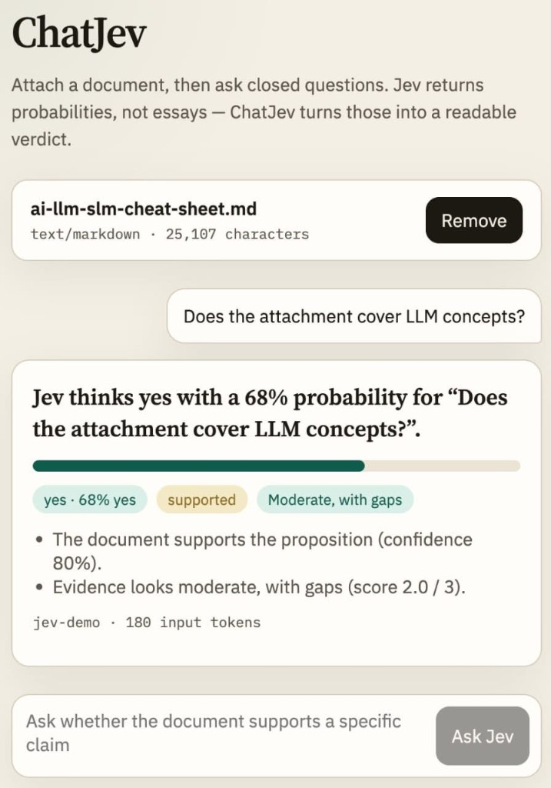

# ChatJev

Attach a document and ask [Jev](https://learnjev.com/reference) questions about it.

Jev is not a chat model. It takes extracted text as `state` and returns typed judgments (`noul`, `choice`, `score`). ChatJev is a Next.js app: one document per session, many follow-up questions, and a human-readable sentence such as “Jev thinks yes with a 90% probability…”.

Closed yes/no questions go straight to Jev. Any other question is turned into a multiple-choice exam: a language model writes the choices, Jev assigns a probability to each one, and ChatJev reads the winning choice as a sentence.

The TypeSafe key stays on the server. The browser only uploads a file and asks questions.



## Feasibility

| Layer                                      | Generic?  | What ChatJev does                                                                        |
| ------------------------------------------ | --------- | ---------------------------------------------------------------------------------------- |
| Domain (medical, legal, finance, anything) | Yes       | Jev evaluates the supplied text. There are no medical- or legal-specific schemas.        |
| File type                                  | Partially | Jev is text-only. ChatJev extracts text from common document types and rejects the rest. |
| Question type                              | Yes       | Closed questions stay yes/no judgments. Other questions become a multiple-choice exam that Jev scores. |

Jev’s state budget is about **32,000 tokens**. ChatJev estimates 4 characters per token and **truncates with a visible warning** rather than silently chunking.

## Supported files

- Text: `.txt`, `.md`, `.csv`, `.json`, `.html`
- Documents: `.pdf`, `.docx`

Not supported in v1: images, scanned PDFs (no OCR), audio, video, and unknown binaries.

## Local setup

Node 22 or newer. Get a key from [console.typesafe.ai](https://console.typesafe.ai). Open questions also need [AI Gateway](https://vercel.com/docs/ai-gateway) access: set `AI_GATEWAY_API_KEY` locally, or deploy on Vercel and use the project's OIDC token. `AI_GATEWAY_MODEL` defaults to `openai/gpt-5.4-mini`; override it with an id from `https://ai-gateway.vercel.sh/v1/models`.

```bash
npm install
cp .env.example .env.local
```

Set `TYPESAFE_API_KEY` in `.env.local`. Optional: `TYPESAFE_DEFAULT_MODEL` (defaults to `jev-latest`).

```bash
npm test
npm run dev
```

Open http://127.0.0.1:3000.

To click through the UI without calling TypeSafe or AI Gateway:

```bash
CHATJEV_MOCK_JEV=1 npm run dev
```

`CHATJEV_HEURISTIC_EXAM=1` keeps the real Jev client and designs exam choices locally, without a language model.

## Deploy on Vercel

The app is a standard Next.js project. The Jev key must be a server env var, never `NEXT_PUBLIC_`.

```bash
npx vercel link
echo "$TYPESAFE_API_KEY" | npx vercel env add TYPESAFE_API_KEY production preview development
npx vercel --prod
```

## API

| Method | Path            | Purpose                                                                      |
| ------ | --------------- | ---------------------------------------------------------------------------- |
| `POST` | `/api/sessions` | Multipart upload (`file`). Returns extracted document text for the next ask. |
| `POST` | `/api/ask`      | JSON `{ question, document }`. Returns a verdict or a refusal.               |

Document text is held in the browser after extract so Vercel serverless instances do not need shared session memory.

## Tests

`npm test` uses a fake Jev client. CI never calls TypeSafe.

## Layout

```
src/core/        ingest, classify, compile, Jev client, verdict copy
src/lib/         route helpers and browser client
src/app/         Next.js App Router pages and API routes
src/components/  chat UI
tests/           Vitest
```

## Out of scope

- OCR / scanned PDFs
- Chunk-and-aggregate for book-length documents
- Prose written by a generative model. The final sentence is a template over Jev’s probabilities.
- Durable session storage
- Streaming (Jev has no stream endpoint)

## License

[MIT](LICENSE)
