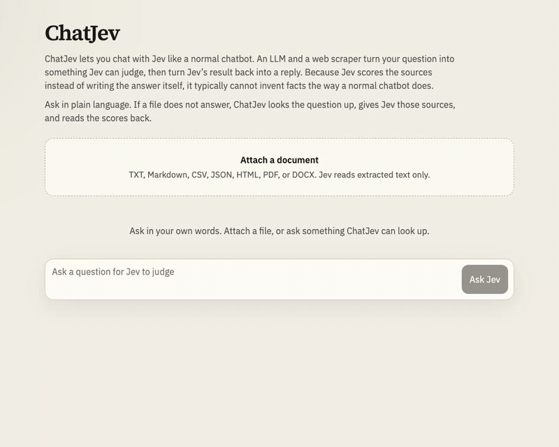

# ChatJev

Ask [Jev](https://learnjev.com/reference) to judge a document or a web lookup, then read the scores in plain language.

Jev is not a chat model. It takes text as `state` and returns typed judgments (`noul`, `choice`, `score`). A fast language model turns the user’s question into those judgments, can attach web excerpts as evidence, and then restates only Jev’s numbers. The verdict card still shows each judgment, so the paragraph can be checked.

The TypeSafe key and the AI Gateway credential stay on the server. The browser uploads a file and asks questions.



## Feasibility

| Layer                                      | Generic?  | What ChatJev does                                                                        |
| ------------------------------------------ | --------- | ---------------------------------------------------------------------------------------- |
| Domain (medical, legal, finance, anything) | Yes       | Jev evaluates the supplied text. There are no medical- or legal-specific schemas.        |
| File type                                  | Partially | Jev is text-only. ChatJev extracts text from common document types and rejects the rest. |
| Question type                              | Yes       | Yes/no claims stay direct judgments. Other questions become a multiple-choice exam that Jev scores, then a sentence. A rejected formulation is repaired, then retried in several different shapes. Questions the file does not answer are looked up on the web, and those excerpts are given to Jev. |

Jev’s state budget is about **32,000 tokens**. ChatJev estimates 4 characters per token and **truncates with a visible warning** rather than silently chunking.

## Supported files

- Text: `.txt`, `.md`, `.csv`, `.json`, `.html`
- Documents: `.pdf`, `.docx`

Not supported in v1: images, scanned PDFs (no OCR), audio, video, and unknown binaries.

## Local setup

Node 22 or newer. Get a Jev key from [console.typesafe.ai](https://console.typesafe.ai). Model calls use the [Vercel AI Gateway](https://vercel.com/docs/ai-gateway) with `openai/gpt-4.1-mini`.

```bash
npm install
cp .env.example .env.local
```

Set `TYPESAFE_API_KEY` in `.env.local`. The compiler defaults to DeepSeek (`DEEPSEEK_API_KEY`, model `deepseek-chat`) and looks up the web with TinyFish through Monid (`MONID_API_KEY`). Set `CHATJEV_LLM_PROVIDER=openai` to use `OPENAI_API_KEY` and `CHATJEV_LLM_MODEL` instead, or `CHATJEV_LLM_PROVIDER=gateway` to use the Vercel AI Gateway and Perplexity search (`AI_GATEWAY_API_KEY` or a `VERCEL_OIDC_TOKEN` from `vercel env pull`). Optional: `TYPESAFE_DEFAULT_MODEL` (defaults to `jev-latest`). If one of those variables is missing, the front page shows a warning instead of answering as though the model ran.

```bash
npm test
npm run dev
```

Open http://127.0.0.1:3000.

To click through the UI without calling TypeSafe or the AI Gateway:

```bash
CHATJEV_MOCK_JEV=1 npm run dev
```

## Deploy on Vercel

The app is a standard Next.js project. The Jev key must be a server env var, never `NEXT_PUBLIC_`.

```bash
npx vercel link
echo "$TYPESAFE_API_KEY" | npx vercel env add TYPESAFE_API_KEY production preview development
npx vercel --prod
```

## API

| Method | Path            | Purpose                                                                      |
| ------ | --------------- | ---------------------------------------------------------------------------- |
| `POST` | `/api/sessions` | Multipart upload (`file`). Returns extracted document text for the next ask. |
| `POST` | `/api/ask`      | JSON `{ question, document? }`. Returns judgments plus a reading, or a refusal. |

Document text is held in the browser after extract so Vercel serverless instances do not need shared session memory.

## Tests

`npm test` uses a fake Jev client. CI never calls TypeSafe.

## Layout

```
src/core/        ingest, question validation, Jev client, gateway compiler and narrator
src/lib/         route helpers and browser client
src/app/         Next.js App Router pages and API routes
src/components/  chat UI
tests/           Vitest
```

## Out of scope

- OCR / scanned PDFs
- Chunk-and-aggregate for book-length documents
- Durable session storage
- Streaming (Jev has no stream endpoint)

## License

[MIT](LICENSE)
